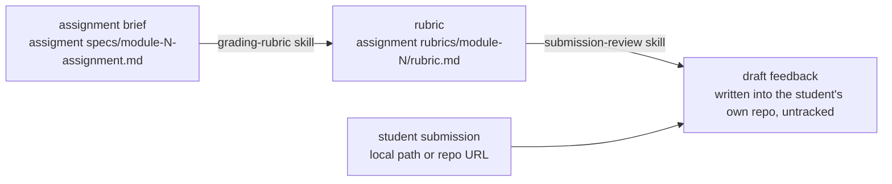

# Grading Workspace — Project Context

> Single source of truth for how grading works in this repo.
> This is a standalone repo, separate from content-factory. Assignments are authored
> there, not here — this repo only grades submissions against them.

---

## What this project is

An isolated workspace for grading student submissions. It exists so grading can happen
without the content-authoring repo (content-factory) open or in scope — no pipelines,
no skill maps, no cohort/team data live here. Assignment briefs arrive here as finished
artifacts; this repo never edits or originates them.

---

## The grading workflow



1. **`grading-rubric`** — run once per assignment. Reads the brief, decomposes Core (and
   Stretch/Optional) requirements into atomic checklist items, classifies each as
   mechanically verifiable or instructor judgment, turns worked examples into exact
   reproduction checks, and saves the result as a rubric. Always presented for instructor
   review before saving — never saved unconfirmed.
2. **`submission-review`** — run once per student submission. Reads the saved rubric,
   actually builds/runs the student's code, executes every mechanically verifiable check
   for real, and leaves every judgment-call item open. Output is a draft feedback file
   written directly into the student's own repo as an **untracked** file — this skill
   never commits or pushes there, under any circumstance. Committing/pushing that file is
   the instructor's action alone.

---

## Folder structure

```
GradingWorkspace/
├── PROJECT.md
├── README.md
├── .claude/
│   └── commands/
│       ├── grading-rubric.md        ← /grading-rubric slash command
│       └── submission-review.md     ← /submission-review slash command
├── skills/
│   ├── grading-rubric/SKILL.md
│   └── submission-review/SKILL.md
├── assigment specs/                 ← assignment briefs, copied in from content-factory
│   ├── module-[n]-assignment.md
│   └── [supporting files, e.g. seed data referenced by a brief]
└── assignment rubrics/
    └── module-[n]/
        └── rubric.md                ← output of grading-rubric
```

Student submissions themselves are never stored in this repo — `submission-review`
operates on a local clone or path outside this workspace and writes its output there,
not here.

---

## Naming conventions

- Assignment briefs: `assigment specs/module-[n]-assignment.md` (note the existing folder
  name — `assigment`, not `assignment` — kept as-is for consistency with what's already
  committed; don't silently rename it).
- Rubrics: `assignment rubrics/module-[n]/rubric.md`, one per assignment.
- Student feedback drafts: written into the student's own repo (not this one), filename
  established by `submission-review`'s Step 6 (e.g. `GRADING-FEEDBACK.md` at repo root)
  unless a different location is already established.

---

## Hard rules

- This repo does not author or edit assignment briefs. If a brief is wrong, that's a
  content-factory problem — flag it, don't fix it here.
- `submission-review` never runs `git add`, `git commit`, or `git push` inside a student's
  repo, ever, including on revisions. The instructor commits and pushes feedback
  themselves, once, when satisfied.
- Judgment-call items (code quality, "is this bad enough to flag") are never pre-scored by
  an agent — they stay open text for the instructor, in both the rubric and the filled
  review.
- A rubric is never saved without the instructor reviewing and confirming it first.
