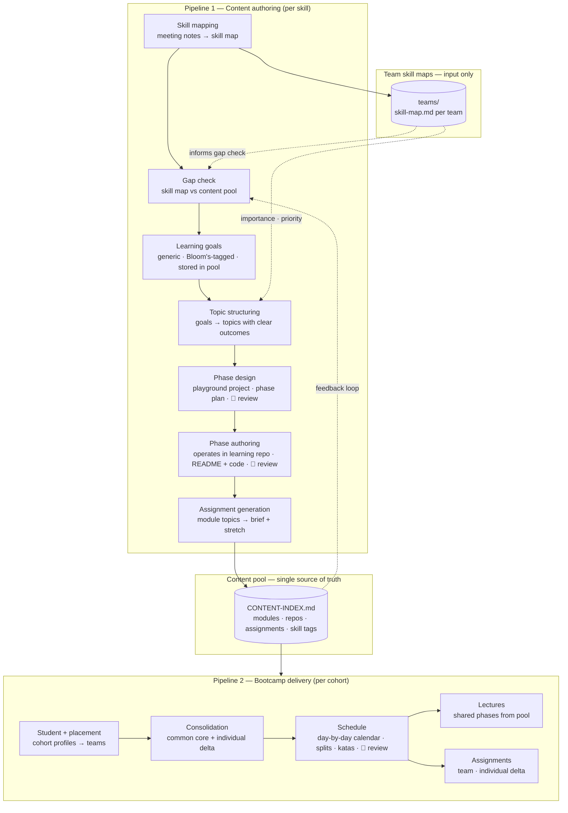

# Bootcamp Content Project — Global Context

> This document is the single source of truth for how this project works.
> Every skill, pipeline, and piece of content references this file.
> When rules change, change them here.

---

## What this project is

A content factory for a consultancy bootcamp that trains students and places them
with client teams. Content is created once, stored in a shared pool, and reused
or composed per cohort. Client teams define what skills are needed via skill maps.
The content pool satisfies those needs. The bootcamp delivery pipeline selects and
sequences content for each cohort based on who is going where.

We run approximately two bootcamps per year. Each cohort is 8–12 students placed
across 8–9 client teams.

---

## The two pipelines



---

## Content model

The primary teaching unit is a **phase** — a branch of a learning repo with a README
that covers the full Bloom's range for a topic. There are no separate slides, workshops,
or kata files. Everything lives in the README, anchored to real runnable code.

```
Learning repo           (spans one or more modules · built incrementally)
└── Phase               (one branch · one topic cluster · one README)
    ├── README.md       (knowledge · concepts · diagrams · what to notice ·
    │                    challenges · thought pieces · discussion prompts)
    └── Code            (the working example students read, run, and fork)

Module                  (1 week · defined by phase slice)
├── Topics              (atomic teachable units · each has one clear practical outcome)
└── Assignment (Friday) (separate applied context · new codebase · has stretch variant)
```

**Key principle:** The learning repo and the assignment are parallel, not sequential.
The assignment is given on day one of the module. The repo phases are the curriculum
students learn from. The assignment is where they prove they can apply it in a new context.

**Content types:**

| Type | Purpose | Format |
|---|---|---|
| Phase README | Primary teaching unit — full Bloom's range | `README.md` in repo branch |
| Assignment | Module-level applied brief + stretch variant | `assignment.md` |

Slides are a derived output only — generated from README content if needed, never
maintained as a primary source. Discussion prompts live inside the phase README as
challenges and thought pieces.

**Learning goals — two layers:**

| Layer | What it is | Where it lives |
|---|---|---|
| Generic goals | Bloom's-tagged goals for a module — reusable, not tied to any repo or domain | `content/pool/modules/[module-slug]/goals.md` |
| Applied goals | Generic goals expressed in the context of a specific phase and codebase | Section 8 of the phase README |

Phase design is where generic goals become applied goals. A module may span 2–3 phases; the applied goals are distributed across those phases accordingly. Phase design and phase authoring must pull the full `goals.md` for the module as their primary input.

---

## The Tractus standard

The gold standard for phase READMEs. The template lives at `templates/phase-readme.md`.
Every phase-authoring output must follow this structure in order:

1. **Header + preamble** — phase title, repo name, one-line summary, problem statement (why this phase exists at this point)
2. **Contents** — TOC linking to each section
3. **Branch sequence table** — where this phase sits in the full repo progression
4. **Resolving the thought pieces** — answers to the open questions seeded by the previous phase
5. **Why we made this decision** — the key design or architectural choice this phase makes, and what the alternatives were; if a library or abstraction is introduced, explain what it replaced
6. **What we built in the previous branch** — one paragraph handover from the prior phase
7. **What we're doing in this branch** — concrete bullet list of what gets added
8. **The abstraction we earned** *(conditional — only when a phase genuinely replaces tedious or unsafe manual work)* — what the abstraction buys, stated concretely
9. **Learning goals** — applied goals grouped by Bloom's level, expressed in the context of this codebase
10. **Key concepts** — table of concept → plain English definition (one row per thought-piece goal)
11. **What to notice in the code** — file-by-file callouts linked to actual source; completed after code is written
12. **What this phase revealed** *(conditional — only when the phase exposes a design gap or friction point)* — named explicitly as a learning moment
13. **Running this branch** — exact build and run commands; completed after code is written
14. **Challenges for students** — 3–5 challenges mixing analytical (think and explain) with additive (extend the code)
15. **Thought pieces for the next branch** — 2–4 open questions this phase raises but does not answer

---

## Bloom's taxonomy — reference and rules

| Level | Verbs to use | Expressed in phase as |
|---|---|---|
| Remember | list, recall, identify, name | Key concepts table · learning goals |
| Understand | explain, describe, summarise, classify | README narrative · "what to notice" |
| Apply | use, implement, solve, demonstrate | Additive challenges · assignment |
| Analyse | compare, differentiate, break down, examine | Analytical challenges · thought pieces |
| Evaluate | justify, critique, argue, assess | Analytical challenges · discussion prompts |
| Create | design, build, produce, formulate | Assignment · stretch variant |

**Rules:**
- Every learning goal starts with an observable Bloom's verb
- Avoid vague verbs: understand, know, learn, appreciate, be aware of
- One skill, one verb, one context per goal
- Goals must be achievable within the scope of a topic
- Do not mix Bloom's levels within a single goal

**Goal format:**
```
[verb] [what] [in what context / to what standard]

Examples:
  Implement a REST API endpoint using Spring Boot that handles GET and POST requests
  Explain the difference between authentication and authorisation in a web application
  Contrast manual constructor injection with Spring DI — what changed, what stayed the same
```

---

## Importance scale

| Level | Meaning |
|---|---|
| **Critical** | Absolutely essential — must be covered |
| **Important** | Needed for success — high priority |
| **Necessary** | Required but less urgent |
| **Useful** | Often helpful — include if time allows |
| **Supportive** | Adds value — optional enrichment |
| **Unnecessary** | Not needed for this team / cohort |

Content authoring focuses on **Critical** and **Important** first.

---

## Proficiency scale

| Level | Meaning |
|---|---|
| **Beginner** | Basic understanding, requires guidance |
| **Intermediate** | Can work independently with verification |
| **Proficient** | Reliable and effective without support |
| **Advanced** | Expert level, can teach or lead |
| **Master** | Recognised authority in the skill |

The proficiency target informs how deep a phase goes and what the assignment asks for.

**Standing assumption for this bootcamp:** The proficiency target is always **Intermediate to Proficient**. This is a constant baked into all content authoring — it is not a variable input to any skill in the pipeline.

---

## Skill categories

- **Technical skills** — languages, frameworks, tools, platforms
- **Developer skills** — practices, patterns, process (clean code, TDD, git, etc.)
- **Domain knowledge** — industry or team-specific context (telecom, finance, etc.)

Domain knowledge is team-specific and does not get promoted to core pool content.
Technical and developer skills are candidates for shared pool content.

---

## Canonical skill taxonomy

All skill maps and content pool tags use names from this table. Matching is exact —
copy the **Name** column verbatim. Sub-topics listed in **Covers** are taught within
that skill's module; they do not get their own rows in a skill map. Preserve them in
the Notes column of the parent skill entry.

| Name | Category | Covers |
|---|---|---|
| **Languages** | | |
| C | Technical | Pointers, memory management, data structures, embedded C patterns, low-level I/O |
| C++ | Technical | Bit manipulation, binary serialisation, pointer arithmetic, memory management, OOP, templates, STL |
| C# | Technical | .NET platform, LINQ, async patterns |
| Java | Technical | Core language, JVM, generics, streams, collections |
| Kotlin | Technical | Null-safety, data classes, extension functions, coroutines, JVM interop with Java |
| JavaScript | Technical | ES6+, async/await, DOM manipulation, event handling |
| TypeScript | Technical | Type annotations, interfaces, generics |
| Python | Technical | Scripting, data processing, pip, virtual environments |
| Rust | Technical | Ownership model, borrowing, memory safety, Cargo |
| **Frameworks — Web & UI** | | |
| Spring Boot | Technical | REST, dependency injection, configuration, Spring Data, Spring Security |
| ASP.NET | Technical | ASP.NET Core Web API — controllers, middleware, dependency injection, configuration |
| React | Technical | Components, hooks, state management, routing |
| Vue | Technical | Vue 3, composition API, Vuex/Pinia, Vue Router |
| Angular | Technical | Components, services, dependency injection, RxJS |
| WPF | Technical | |
| Windows Forms | Technical | |
| Blazor | Technical | |
| Qt | Technical | Qt Widgets, Qt Quick, signals/slots, CMake integration |
| **APIs & Data** | | |
| REST APIs | Technical | HTTP semantics, DTOs, status codes, error handling, versioning |
| GraphQL | Technical | Schema definition, queries, mutations, resolvers |
| SQL | Technical | Schema design, joins, indexing, transactions, query optimisation |
| PostgreSQL | Technical | Relational DB, schema/performance design |
| PostGIS | Technical | Spatial queries, geographic indexing, GIS data models |
| TimescaleDB | Technical | Time-series queries, hypertables, continuous aggregates |
| JPA / Hibernate | Technical | ORM mapping, relationships, JPQL, lazy/eager loading |
| Entity Framework | Technical | .NET ORM — DbContext, migrations, LINQ-to-Entities, relationships, lazy/eager loading |
| ADO.NET | Technical | .NET SQL client — SqlConnection/SqlCommand, parameterized queries, result-set mapping |
| JDBC | Technical | Java SQL client — connection handling, PreparedStatement, result-set mapping |
| Message Queues | Technical | Redis as broker, RabbitMQ, AMQP, pub/sub, event-driven patterns |
| Protocol Buffers | Technical | Binary serialisation schemas, schema evolution, encoding efficiency, cross-language compatibility |
| Authentication & Authorization | Technical | JWT, OAuth 2.0, token-based auth, session management |
| **Systems & Infrastructure** | | |
| Docker | Technical | Containers, images, Dockerfile, Compose, deployment |
| Linux | Technical | CLI, shell scripting, process management, filesystem |
| Bash Scripting | Technical | Shell scripts — variables, control flow, pipes/redirection, common CLI tool composition |
| CMake | Technical | C++ build configuration, dependency management |
| FPGA | Technical | HDL (VHDL / Verilog / SystemVerilog), synthesis, timing constraints, IP core integration, HLS |
| Embedded Development | Technical | Bare metal programming, MCU programming, HAL design, peripheral drivers, interrupts, memory-mapped I/O, embedded toolchains |
| Debugging (Embedded Systems) | Technical | JTAG/SWD debug probes, breakpoints on target hardware, logic analyzers/oscilloscopes — distinct from Algorithmic Problem Solving's general systematic debugging |
| Industrial Protocols & PLC Integration | Technical | Fieldbus/industrial protocols (Modbus, etc.), programmable logic controller integration |
| RTOS | Technical | FreeRTOS, VxWorks, Zephyr — task scheduling, semaphores, mutexes, interrupt-driven design, real-time constraints |
| Embedded Linux | Technical | Running and administering Linux on embedded targets — distinct from Yocto (the build system) and from bare-metal/RTOS work |
| Yocto | Technical | Embedded Linux distribution build system |
| ROS2 | Technical | Robotics middleware, nodes, topics, services |
| Computer Vision | Technical | Image processing, object detection, camera calibration, OpenCV, deep learning inference |
| Async / Concurrency | Technical | async/await, threads, task-based programming |
| TCP/IP | Technical | Network fundamentals, IPv4/IPv6 |
| SSL/TLS | Technical | TLS handshake, certificate model |
| Embedded Security | Technical | Secure boot, encrypted comms, hardware security modules, side-channel awareness — distinct from Safety-Critical Development Practices (functional safety, not security) |
| Map Rendering Libraries | Technical | Leaflet, Mapbox, OpenLayers — geospatial UI |
| Electronics Design | Technical | Schematic capture, PCB layout, component selection, circuit analysis, signal integrity basics |
| Hardware-Electronics Basics | Technical | Electronics fundamentals for software engineers — voltage/current, digital logic, sensors/actuators; distinct from Electronics Design (PCB layout is EE-focused) |
| Control Systems / Controllers Theory | Technical | Feedback loops, PID control, controller design fundamentals |
| **Platforms & Tools** | | |
| Visual Studio | Technical | |
| NuGet | Technical | .NET package management |
| GitLab | Technical | GitLab platform, merge requests, GitLab CI |
| Cadence | Technical | Cadence Allegro / OrCAD — schematic capture, PCB layout, design rule checks |
| Figma | Technical | Design handoff, prototyping, component libraries, design-to-code workflow |
| **Developer Skills** | | |
| Git | Developer | Branching, PRs, conflict resolution |
| Clean Code | Developer | Naming, function size, readability |
| SOLID Principles | Developer | |
| Design Patterns | Developer | Layered architecture, common GoF patterns |
| Software Architecture | Developer | System design, architectural patterns, microservices |
| Legacy Code | Developer | Refactoring, working safely with existing codebases |
| Safety-Critical Development Practices | Developer | Process/discipline for functional safety in critical systems — distinct from Embedded Security (which is about security, not safety) |
| TDD | Developer | Red–green–refactor discipline |
| Testing | Developer | Unit, integration, E2E, and component testing — frameworks and practices beyond TDD discipline |
| Algorithmic Problem Solving | Developer | Decomposition, complexity reasoning, systematic debugging |
| Documentation | Developer | Code docs, API documentation, OpenAPI / Swagger |
| Coding Standards | Developer | Formal adherence to a team/project style guide or convention — distinct from Clean Code's readability principles |
| CI/CD | Developer | Automated build and test pipelines |
| AI Agentic Development | Developer | Agent loops, context engineering, tool/skill delegation, behaviour shaping, guardrails & permissions, verification practices |
| A/B Testing & Experimentation | Developer | Experiment design, hypothesis-driven iteration, statistical significance, funnel/conversion measurement |
| UX / Product Thinking | Developer | User-centred design reasoning, basic UX literacy and heuristics, product sense, balancing user needs with business goals |
| Feature Flags & Controlled Rollout | Developer | Progressive rollout, canary releases, kill switches, flag-based deployment |

> New skills surface when team maps are extracted. Add them here before saving the map.
> Domain knowledge is never added to this taxonomy.

---

## Skills list

### Pipeline 1 — Content authoring

| Skill | Purpose | Key inputs beyond PROJECT.md |
|---|---|---|
| `skill-map-extraction` | Meeting notes → structured skill map | Meeting notes · team role |
| `pool-gap-check` | Skill map vs pool → what's missing | Skill map · CONTENT-INDEX.md |
| `learning-goals` | Module theme + skills → generic Bloom's-tagged goals stored in pool | Module theme · skills to cover |
| `lesson-structuring` | Module goals → topics with clear practical outcomes | `goals.md` |
| `topic-routing` | Topics → routing decision (repo vs workshop) per topic, confirmed by instructor | `topics.md` · `goals.md` |
| `phase-design` | Topics → playground project · phase plan with code goals and thought piece goals per phase | `topics.md` · `phase-readme.md` template · 👤 human review |
| `phase-authoring` | Phase plan entry → committed phase branch (SOLUTION + README + code) | `phase-plan.md` · `phase-readme.md` template · 👤 human review · operates in learning repo |
| `phase-review` | Multi-agent correctness review for a phase — flags UB, leaks, README inaccuracies; suppresses pedagogically intentional findings | Phase README · phase source files · operates in learning repo |
| `workshop-authoring` | Topic + type → scenario-first workshop document (lab, case study, or configuration exercise) | `goals.md` · `topics.md` · `templates/workshop.md` |
| `kata-generation` | Module topics → daily warm-up katas with stretch variants | `topics.md` · `goals.md` |
| `assignment-generator` | Module goals → brief + stretch variant | Module goals · student profile |

### Pipeline 2 — Bootcamp delivery

| Skill | Purpose | Key inputs beyond PROJECT.md |
|---|---|---|
| `cohort-skill-map-consolidation` | Team skill maps → common core + delta | All team maps · priority scale |
| `cohort-schedule` | Consolidation → day-by-day teaching calendar with splits and katas | `consolidation.md` · `katas.md` per module · CONTENT-INDEX.md · 👤 human review |
| `student-learning-track` | Student CV + consolidation → personalised entry-level profile | CV · `consolidation.md` |

---

## Naming conventions

### Files and folders
- All lowercase, hyphens for spaces: `state-management/`, `topic.md`
- Repo folders: `[repo-name]/` e.g. `tractus/`
- Phase reference files: `[phase-slug].md` e.g. `phase-04-spring-di.md`
- Assignment files: `content/pool/assignments/[module-slug]/assignment.md` (single-module) or
  `content/pool/assignments/milestones/[milestone-slug]/assignment.md` (spans multiple modules — see
  `assignment-generator` skill)
- Team skill maps: `teams/[team-name]/skill-map.md`

### Content types in filenames
`.readme.md` · `.assignment.md` · `.slides.md` (derived only)

---

## Folder structure

All learning repos live as siblings of `content-factory/` under a shared parent directory.
The `../content-factory/` relative path is the stable reference used in every repo's `CLAUDE.md`.

```
[parent]/
├── content-factory/       ← this project
│   ├── PROJECT.md
├── CONTENT-INDEX.md
│
├── skills/
│   ├── pipeline-1-content-authoring/
│   │   ├── skill-map-extraction/SKILL.md
│   │   ├── pool-gap-check/SKILL.md
│   │   ├── learning-goals/SKILL.md
│   │   ├── lesson-structuring/SKILL.md
│   │   ├── topic-routing/SKILL.md
│   │   ├── phase-design/SKILL.md
│   │   ├── phase-authoring/SKILL.md
│   │   ├── phase-review/SKILL.md
│   │   ├── workshop-authoring/SKILL.md
│   │   ├── kata-generation/SKILL.md
│   │   └── assignment-generator/SKILL.md
│   └── pipeline-2-bootcamp-delivery/
│       ├── cohort-skill-map-consolidation/SKILL.md
│       ├── cohort-schedule/SKILL.md
│       └── student-learning-track/SKILL.md
│
├── teams/
│   └── [team-name]/
│       └── skill-map.md
│
├── content/
│   └── pool/
│       ├── modules/
│       │   └── [module-slug]/
│       │       ├── goals.md        ← generic Bloom's-tagged goals · reusable · not repo-specific
│       │       └── topics.md       ← atomic teachable units · one clear outcome each
│       ├── repos/
│       │   └── [repo-name]/
│       │       ├── repo.md         ← metadata: module mapping · phase index · build status
│       │       └── phase-plan.md   ← phase design output · pulled as context when building repo
│       ├── assignments/
│       │   └── [module-slug]/
│       │       └── assignment.md
│       └── workshops/
│           └── [workshop-slug]/
│               └── workshop.md     ← scenario-first document; lab, case study, or config exercise
│
│   └── templates/
│       ├── skill-map.md
│       ├── phase-readme.md             ← Tractus standard template
│       └── assignment.md
│
└── [repo-name]/               ← learning repos as siblings
    ├── CLAUDE.md              ← references content-factory via ../content-factory/
    ├── main                   ← scaffold only
    └── phase-0N_slug          ← one branch per phase
```

---

## Starting a new repo

When a phase plan is confirmed and it is time to build the learning repo, follow this
setup exactly. Nothing should be authored until these steps are complete.

### Directory convention

All learning repos live in the **same parent directory** as the content factory:

```
[parent]/
├── content-factory/       ← this project
├── xenolog/               ← C++ learning repo
├── another-repo/          ← any future learning repo
└── ...
```

This allows every learning repo to reference the content factory via a stable relative
path: `../content-factory/`. References stay correct across machines as long as this
sibling structure is maintained. Skills, templates, and the phase plan are always
referenced — never copied — so any update to them takes effect immediately in all repos.

### Prerequisites

The following must exist in the content factory before the repo is created:
- `content/pool/repos/[repo-name]/phase-plan.md` — confirmed by the instructor
- `content/pool/repos/[repo-name]/repo.md` — stub created by phase-design skill

### Step 1 — Create the repo

Create the repo folder as a sibling of `content-factory/`, then initialise git inside it:

```
mkdir [repo-name]
cd [repo-name]
git init
git checkout -b main
```

Add build scaffolding (CMakeLists.txt, Makefile, .gitignore, etc.) and a `main.cpp`
that compiles and runs — a startup message that identifies the project. Then add a root
`README.md` with the project brief, prerequisites, build/run instructions, and the full
branch sequence table from the phase plan. Commit both:

```
CHORE: initialise repo with build scaffolding and hello world
DOCS: add root README with project brief and branch sequence
```

The `.gitignore` must include:
```
.claude/
CLAUDE.md
```
These are instructor tooling — Claude Code context files that should never be pushed to
the student-facing remote. Students cloning the repo should not see them.

Then create `docs/PRD.md` — a student-facing Product Requirement Document derived from
the PRD section of `phase-plan.md`. This gives students the engineering context for what
they are building, why it exists, and what it is not. Commit separately:

```
DOCS: add PRD
```

`main` is what every student clones. It must compile and run before Phase 1 starts.

### Step 2 — Create CLAUDE.md

Create a `CLAUDE.md` at the repo root. Claude Code reads this automatically whenever
an agent is opened in this repo. Use relative paths via `../content-factory/`.

```markdown
# [Repo Name]

Read the following before doing anything:

1. ../content-factory/PROJECT.md — global rules, standards, commit convention
2. ../content-factory/skills/pipeline-1-content-authoring/phase-authoring/SKILL.md — how phases are authored
3. ../content-factory/templates/phase-readme.md — README structure
4. ../content-factory/content/pool/repos/[repo-name]/phase-plan.md — what to build

## Commit convention
FEAT · REFACTOR · DOCS · SOLUTION · CHORE · FIX — single line, no body.

## Comment rules
Single-line comments use `//`. Multi-line comments use `/* */` (collapsible in IDE).
Solution comments must reference the challenge number: `// SOLUTION (Challenge N):`.
```

Commit:
```
CHORE: add CLAUDE.md with content factory context references
```

### Step 3 — Add slash commands

Copy the repo-ready command files into `.claude/commands/`. These are thin wrappers
that delegate to the context already loaded by CLAUDE.md — they contain no skill logic
and do not need updating when skills change.

```
mkdir .claude\commands
copy ..\content-factory\templates\repo-commands\phase-authoring.md .claude\commands\phase-authoring.md
```

Commit:
```
CHORE: add Claude Code slash commands
```

### Step 4 — Author phases

Open the repo in Claude Code. Run:
```
/phase-authoring phase-01
```

The phase-authoring skill handles the rest. It enforces the sequence for every phase:
1. **SOLUTION commit** — resolve previous phase's challenges and thought pieces
2. **DOCS commit** — README for the new phase
3. **Human review** — instructor confirms before any code is written
4. **FEAT/REFACTOR commits** — code additions in logical units
5. **DOCS commit** — complete README with code references and run instructions

### Never

- Write code before the phase README is drafted and reviewed
- Skip the SOLUTION commit when entering a new phase (except Phase 1)
- Commit without a type prefix
- Mix multiple phases in one branch
